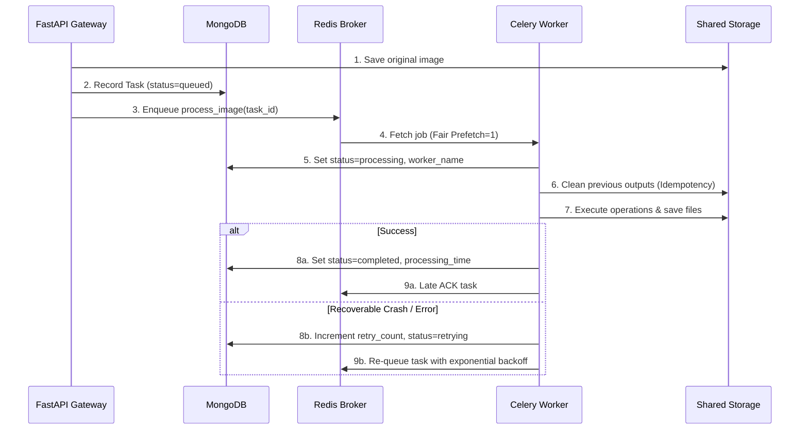

# Cloud-Based Distributed Image Processing System — Architecture

## 1. System Overview

The **Cloud-Based Distributed Image Processing and Task Scheduling System** is designed for the university semester course **Cloud and Distributed Computing (CDC)**. It demonstrates core distributed systems principles including asynchronous task queues, horizontal worker scaling, centralized message brokering, shared persistent storage, fault-tolerant retries, and empirical performance benchmarking (Amdahl's Law).

```
                                      +------------------------------------+
                                      |          React 19 Frontend         |
                                      |   (Vite + TypeScript + Tailwind)   |
                                      +-----------------+------------------+
                                                        |
                                              HTTP / REST API Calls
                                                        |
                                                        v
                                      +-----------------+------------------+
                                      |         FastAPI Gateway            |
                                      |    (Validation + Auth + CRUD)      |
                                      +--------+--------+---------+--------+
                                               |        |         |
                          +--------------------+        |         +-------------------+
                          | Metadata & State            | Task Enqueue                | Binary Files
                          v                             v                             v
               +----------+---------+         +---------+---------+        +----------+---------+
               |      MongoDB       |         |   Redis Broker    |        |   Shared Storage   |
               | (Tasks, Batches,   |         |   (Task Queue     |        | (Docker Volume or  |
               |  Benchmarks)       |         |   & Results)      |        |  AWS S3 Bucket)    |
               +----------+---------+         +---------+---------+        +----------+---------+
                          ^                             |                             ^
                          |                             | Pull Jobs (Fair Prefetch)   | Read/Write
                          |                             v                             |
                          |                   +---------+---------+                   |
                          +-------------------|   Celery Worker   |-------------------+
                          | Updates State     |  Nodes (1..N)     |
                          +-------------------|  (Pillow Engine)  |-------------------+
```

---

## 2. Core Architectural Components

### A. Frontend Layer (React 19, Vite, TypeScript, Tailwind CSS)
- **Framework**: Vite-powered Single Page Application (SPA) utilizing TypeScript for type safety.
- **Styling**: Tailwind CSS with custom responsive utilities, dark navy sidebar, and neutral card surfaces.
- **Charts**: Recharts library visualizing hourly processing throughput, worker load distribution, and parallel speedup vs. ideal linear scaling.
- **State & Polling**: Polling hooks with configurable intervals (3-5s) ensuring real-time dashboard updates.

### B. API Gateway Layer (Python FastAPI)
- **Role**: Validates requests, sniffs image bytes with Pillow, generates UUID task identifiers, saves files into shared storage, registers task metadata in MongoDB, and enqueues job references to Redis.
- **Decoupling**: The API never processes images synchronously. Heavy computations are completely decoupled to background workers.
- **Storage Protection**: Strips unsafe directory paths and resolves targets within designated storage roots to eliminate directory traversal risks.

### C. Message Broker Layer (Redis 7)
- **Role**: Acts as the high-throughput task queue broker (`redis://redis:6379/0`).
- **Binary Payload Avoidance**: Task payloads in Redis contain only lightweight metadata (e.g., `task_id`). Raw image binaries are stored exclusively in shared storage.
- **Queue Semantics**: Default queue with fair worker prefetching (`worker_prefetch_multiplier = 1`).

### D. Distributed Worker Layer (Celery 5 + Pillow)
- **Concurrency**: Independent worker container instances running configurable concurrency pools (`-c 2` or `-c 4`).
- **Late Acknowledgements (`task_acks_late = True`)**: Tasks are acknowledged only **after** successful completion and file write. If a worker container crashes mid-execution, Redis re-queues the task automatically.
- **Worker Crash Recovery (`task_reject_on_worker_lost = True`)**: Unacknowledged messages on lost workers are immediately rejected back to the queue for alternate workers to claim.
- **Idempotency**: Before executing operations, existing outputs for a retried task ID are cleared to prevent duplicate artifacts.

### E. Storage Layer
- **Local Mode**: Shared Docker volume (`image_storage`) mounted across the API and all worker containers at `/app/storage`.
  - `storage/originals/{ref_id}/{filename}`: Unmodified source files.
  - `storage/processed/{task_id}/{filename}`: Processed outputs.
- **Cloud Mode**: AWS S3 bucket integration via `boto3`.

### F. Database Layer (MongoDB 7)
- **Collections**:
  - `tasks`: Full lifecycle state, operations, config, output paths, durations, error strings, and retry counts.
  - `batches`: Aggregated status across batches of multiple uploaded images.
  - `benchmarks`: Empirical wall-clock execution timings, throughput, speedup factors, and parallel efficiency.
- **Async & Sync Drivers**: FastAPI utilizes `motor` for asynchronous I/O; Celery workers utilize `pymongo` for thread-safe synchronous database updates.

---

## 3. Image Processing Operations

The worker executes 8 distinct operations through Pillow:
1. **Resize**: Lanczos resampling to explicit target width and height.
2. **Thumbnail**: Proportional aspect-ratio constrained downsampling within a bounding box.
3. **Compress**: Adjustable quality factor (1-100) with format-specific optimizations.
4. **Convert**: Seamless conversion between JPEG, PNG, and WebP with alpha-channel transparency handling.
5. **Rotate**: Geometric rotation with canvas expansion (`expand=True`) to prevent clipped corners.
6. **Grayscale**: Color channel removal to 8-bit monochrome luminance (`L` mode).
7. **Gaussian Blur**: Convolution filter with customizable pixel blur radius.
8. **Metadata Extraction**: Parsing image dimensions, color mode, aspect ratio, file size, and embedded EXIF tags into JSON artifacts.

---

## 4. Fault Tolerance & Recovery Pipeline


